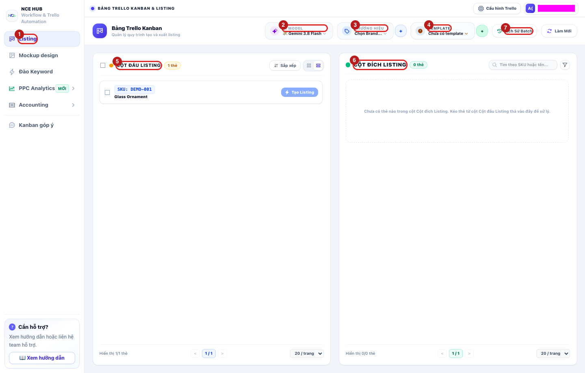
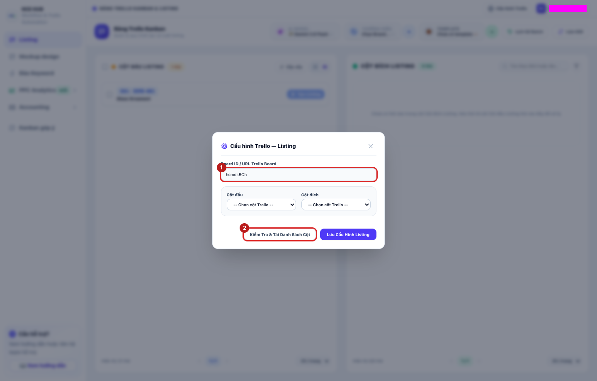
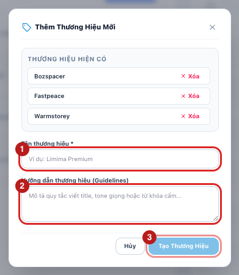
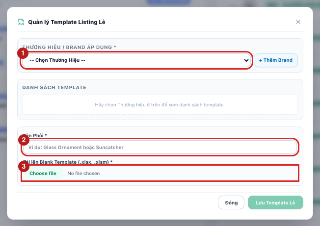
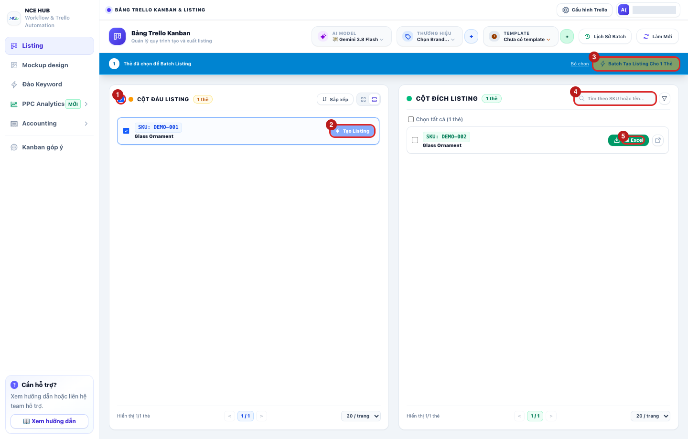
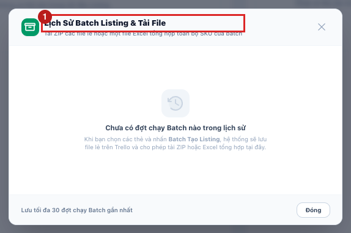

# Hướng dẫn sử dụng Listing trên NCE HUB

Dùng **Listing** để lấy thẻ sản phẩm từ Trello, tạo nội dung bằng AI và xuất file Excel theo template của thương hiệu. Bạn có thể xử lý từng thẻ hoặc chạy nhiều SKU theo batch. Các số khoanh đỏ trong ảnh tương ứng với vị trí thao tác được giải thích bên dưới. Các thẻ có mã `DEMO` là dữ liệu minh họa.

## 1. Làm quen với màn hình Listing

1. Chọn **Listing** ở menu bên trái.
2. Mở **AI Model** để chọn model cho lượt tạo nội dung.
3. Chọn **Thương hiệu** đúng với sản phẩm. Nút **+** cạnh mục này mở phần quản lý thương hiệu.
4. Chọn **Template** đúng loại sản phẩm. Nút **+** cạnh mục này mở phần quản lý template.
5. **Cột đầu Listing** hiển thị thẻ chờ xử lý.
6. **Cột đích Listing** hiển thị thẻ ở cột kết quả trên Trello.
7. Mở **Lịch Sử Batch** để xem tiến độ hoặc tải kết quả của các lần chạy.

Bấm **Làm Mới** sau khi cập nhật thẻ trên Trello. Các cột có phân trang riêng. Dùng nút mũi tên hoặc chọn số thẻ mỗi trang để xem thêm.

## 2. Kết nối board Trello

Nếu hai cột đã hiển thị đúng board của team, bạn có thể bắt đầu ở phần chọn thương hiệu. Nếu cần thiết lập hoặc đổi board, mở **Cấu hình Trello** ở thanh trên cùng.

1. Dán link board Trello hoặc mã board vào ô nhập (1).
2. Bấm **Kiểm Tra & Tải Danh Sách Cột** (2).
3. Khi danh sách cột xuất hiện, chọn **Cột đầu** để lấy thẻ và **Cột đích** để nhận kết quả. Chọn hai cột theo quy trình của team.
4. Bấm **Lưu Cấu Hình Listing** rồi kiểm tra tên cột và danh sách thẻ trên màn hình chính.

Nếu kiểm tra thất bại, mở link trong Trello để xác nhận đúng board và nhờ người quản lý kiểm tra quyền truy cập của kết nối. Nếu board mở được nhưng danh sách trống, kiểm tra xem thẻ đã ở đúng cột đầu chưa, rồi bấm **Làm Mới**.

## 3. Chuẩn bị thương hiệu và template

### Chọn hoặc thêm thương hiệu

1. Mở **Thương hiệu** và chọn brand của SKU sắp chạy.
2. Nếu chưa có brand, bấm **+** cạnh mục **Thương hiệu**, nhập tên (1) và mô tả quy tắc viết (2). Ví dụ, ghi giọng văn, cách viết tiêu đề và cụm từ thương hiệu yêu cầu tránh.
3. Bấm **Tạo Thương Hiệu** (3) rồi chọn lại brand trên thanh công cụ. Kiểm tra danh sách template đã chuyển sang đúng brand.

### Chọn, thêm hoặc cập nhật template

1. Mở **Template** rồi chọn mẫu đúng brand và đúng phôi. Dùng mẫu có trạng thái **Sẵn sàng**.
2. Để thêm mẫu, bấm **+** cạnh mục **Template**, chọn brand (1), nhập tên phôi (2) và tải **Blank Template** (3) định dạng `.xlsx` hoặc `.xlsm`.
3. Chờ hệ thống quét trường bắt buộc. Điền các ô được yêu cầu và chọn giá trị trong danh sách nếu ô có sẵn lựa chọn. Lưu mẫu rồi chọn trên thanh công cụ.
4. Với mẫu có trạng thái **Cần cấu hình**, mở mục **Cấu hình** hoặc dùng thao tác **Nạp đè file Excel mới** trong phần quản lý template. Kiểm tra lại trường bắt buộc trước khi chạy.
5. Trong phần quản lý, dùng nút tải Excel để kiểm tra mẫu đang lưu. Chỉ xóa mẫu hoặc brand khi đã xác nhận team không còn dùng. Kiểm tra lại brand và tên phôi trước khi nạp đè.

## 4. Tạo listing cho một SKU

1. Trong **Cột đầu Listing**, tìm đúng thẻ. Dùng **Sắp xếp**, phân trang hoặc đổi sang dạng dòng thu gọn để duyệt nhanh hơn.
2. Đối chiếu tên thẻ, SKU và ảnh mockup với sản phẩm. Bấm ảnh để phóng to khi cần. Nếu thẻ thiếu ảnh hoặc thông tin, bổ sung trên Trello rồi bấm **Làm Mới**.
3. Kiểm tra **AI Model**, **Thương hiệu** và **Template** đang chọn.
4. Bấm **Tạo Listing & Đính Kèm** trên thẻ. Ở dạng dòng thu gọn, dùng **Tạo Listing** (2). Bạn cũng có thể kéo thẻ từ cột đầu sang cột đích để bắt đầu xử lý.
5. Theo dõi tiến độ. Nếu cần dừng trong lúc xử lý, dùng **Ngắt** trên thẻ. Trước khi chạy lại, kiểm tra file đã có trên thẻ Trello để tránh tạo trùng.
6. Khi có kết quả, mở **Chi Tiết Listing Đã Sinh** để đối chiếu SKU, tiêu đề, bullet points, mô tả và từ khóa với sản phẩm. Kiểm tra kích thước, chất liệu và các thông tin AI có thể diễn giải sai.
7. Dùng nút sao chép nội dung nếu cần đưa sang công cụ khác. Khi xuất Excel, mở file để kiểm tra đúng template, đúng SKU và các ô bắt buộc trước khi dùng ở bước đăng sản phẩm.

## 5. Chạy nhiều SKU bằng Batch Listing

1. Chọn cùng một **Thương hiệu** và **Template** cho nhóm SKU tương thích. Nếu SKU dùng khác mẫu, chia thành các lượt chạy riêng.
2. Tích chọn các thẻ trong **Cột đầu Listing**. Có nút **Chọn/Bỏ chọn tất cả** (1) ở đầu cột trong ảnh ở mục 4. Đọc lại số thẻ đã chọn trước khi gửi.
3. Bấm **Batch Tạo Listing Cho … Thẻ** (3) trên thanh thao tác.
4. Theo dõi thanh tiến độ batch phía trên. Batch chạy ngầm trên server nên có thể chuyển mục sau khi hệ thống xác nhận đã khởi tạo.
5. Mở chi tiết batch để xem từng SKU và thông báo lỗi. Dùng **Tạm dừng**, **Tiếp tục** hoặc **Hủy batch** khi các điều khiển tương ứng xuất hiện. Kiểm tra các SKU đã hoàn tất và file đã đính kèm trước khi chọn chạy lại nhóm lỗi.

## 6. Tìm và tải kết quả

### Tải từ cột đích

1. Dùng ô **Tìm theo SKU hoặc tên...** (4 trong ảnh ở mục 4) để tìm thẻ. Nút lọc bên cạnh cho phép xem tất cả thẻ, thẻ có Excel Listing hoặc thẻ có tệp đính kèm.
2. Bấm **Tải Excel** (5) trên thẻ có file kết quả. Dùng nút mở Trello để xem các tệp đính kèm của thẻ khi cần đối chiếu.
3. Để tải nhiều file lẻ, chọn các thẻ kết quả rồi bấm **Tải ZIP**. Kiểm tra số file trong ZIP và đối chiếu với số thẻ cần bàn giao.

### Tải từ lịch sử batch

1. Bấm **Lịch Sử Batch** trên thanh công cụ để mở hộp **Lịch Sử Batch Listing & Tải File** (1).
2. Chọn lượt chạy dựa trên thời điểm, brand hoặc template và số SKU. Mở chi tiết để kiểm tra SKU hoàn tất và SKU lỗi.
3. Dùng **Tải Excel Tổng Hợp** khi cần một file chung cho batch. Dùng **Tải ZIP** khi cần các file Excel riêng theo SKU. Các nút tải xuất hiện theo dữ liệu kết quả của lượt chạy.
4. Nếu lịch sử chưa hiện lượt vừa gửi, kiểm tra thanh tiến độ và làm mới sau khi hệ thống nhận batch.
5. Tải các file cần giữ trước khi dùng **Xóa lịch sử**. Thao tác này yêu cầu xác nhận và xóa lịch sử lưu trên trình duyệt.

## 7. Kiểm tra trước khi bàn giao

| Tình huống | Việc cần kiểm tra |
| --- | --- |
| Không thấy mục Listing | Kiểm tra tài khoản có quyền mở Listing. |
| Thẻ không xuất hiện ở cột đầu | Kiểm tra board, cột nguồn, trang đang xem và bấm **Làm Mới**. |
| Nút tạo listing chưa bấm được | Chọn thương hiệu và blank template đúng loại sản phẩm. Với batch, kiểm tra đã tích ít nhất một thẻ. |
| Template báo cần cấu hình | Kiểm tra file gốc, trường bắt buộc và danh sách giá trị hợp lệ trước khi lưu. |
| SKU báo lỗi hoặc chưa thấy Excel | Mở chi tiết tiến độ và thẻ Trello để đọc lỗi và kiểm tra file hiện có trước khi chạy lại. |
| Nội dung AI sai thông tin sản phẩm | Đối chiếu ảnh và dữ liệu nguồn. Sửa nội dung và kiểm tra file Excel trước khi bàn giao. |

Hoàn tất một lượt khi bạn đã đối chiếu đúng SKU, thương hiệu, phôi, nội dung và file tải về. Bước đăng sản phẩm lên Amazon thực hiện theo quy trình của team.
